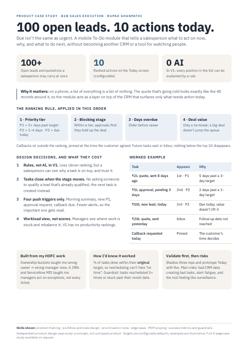

# Sales To-Do Module: "100 open leads. 10 actions today."

> Product case study by **Rupak Ghanpathi** · B2B sales execution

A mobile To-Do module that tells a salesperson what to act on now, why, and what to do next, without becoming another CRM or a tool for watching people.

**[Read the full case study (PDF, 4 pages)](Sales_ToDo_Module_Case_Study.pdf)** · **[One-pager (PDF)](Sales_ToDo_Module_One_Pager.pdf)**

## The problem
On a phone, a list of everything is a list of nothing. The quote that's going cold looks exactly like the 40 records around it.

## The ranking rule (applied in this order)
1. **Priority tier**: P1 = 5+ days past target · P2 = 1–4 days · P3 = due today
2. **Blocking stage**: within a tier, approvals come first
3. **Days overdue**: older before newer
4. **Deal value**: only a tie-break, so a big deal doesn't jump the queue

Callbacks are pinned at the time the customer agreed. Future tasks wait in an Inbox.

## Design decisions
| Decision | Trade-off |
| --- | --- |
| Rules, not AI, in V1 | Less clever ranking, but a salesperson can see why a task is on top |
| Tasks close when the stage moves | No asking someone to qualify a lead that's already qualified |
| Four push triggers only | Fewer alerts, so the important one gets read |
| Workload view, not scores | Managers rebalance stuck work; no productivity rankings in V1 |

## How I'd know it worked
% of tasks done within their **original** target, so rescheduling can't fake "on time". Guardrail: tasks rescheduled 3+ times.

## Skills shown
Problem framing · workflow and state design · prioritisation rules · edge cases · MVP scoping · success metrics and guardrails

---
*Independent product design case study: a concept, not a shipped product. Targets are configurable defaults; examples are illustrative.*
