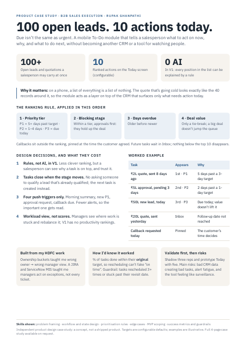

# Sales To-Do Module: "100 open leads. 10 actions today."

> **Live:** [tentoday.vercel.app](https://tentoday.vercel.app) · Product case study by **Rupak Ghanpathi** · B2B sales execution

A mobile To-Do module that tells a salesperson what to act on now, why, and what to do next, without becoming another CRM or a tool for watching people.

**Live site:** [tentoday.vercel.app](https://tentoday.vercel.app) · [Executable specification](https://tentoday.vercel.app/cockpit.html)

## Where it fits
Deals stall between the rep and the approver. Industry surveys suggest slow approvals cost deals: in Conga's own survey, 45% of companies lost a deal in six months to slow quote approval ([Conga](https://conga.com/resources/blog/how-shorten-your-sales-cycle-fix-handoffs-not-hustle), vendor survey). Ten Today freezes the rep's follow-up while a discount approval is pending, puts the clock on the approver, and shows the three numbers needed to decide: ask, margin floor and the customer's overdue balance. Validate with sales heads before relying on it.

## The product (new)
**[tentoday.vercel.app/app.html](https://tentoday.vercel.app/app.html)**: Ten Today as a working product. Switch between Rahul and Neha (sales reps), Kavita (sales manager) and Arjun (sales head); each can only do their own part.
- **Rep:** Today capped at 10 and ranked by the four rules, each with a reason. ✓ Done needs an outcome, and a stage move creates the next task once. Reschedule keeps ageing from the original target, and a second move needs a blocker. On hold needs a reason and a revisit date, and the task comes back by itself.
- **Discount ask:** freezes the task and routes it. Kavita takes up to 10% within the margin floor. The sales head takes anything above that, or any customer 30+ days overdue.
- **Approver:** sees the ask, the margin floor and the overdue balance, then approves with a cap and an expiry, counters (the rep accepts or declines) or sends it back with a reason. Nobody decides their own ask, and nothing stays stuck.
- **Manager:** sees the workload, and a move needs confirming first. Frozen tasks and tasks with an approved discount stay with their rep.
- Every rule lives in `site/engine.js` and is tested in `tests/engine.test.mjs` (26 tests, `node --test tests/engine.test.mjs`), including approval escalation, dealer credit (limit and credit days), schemes with maker-checker and the Every Rupee handoff contract v1. Every action shows its result and the next step.

**Also enforced:** a placed order can't carry more discount than was approved (cap plus scheme), an expired approval blocks the order, and one approval covers one order. Sundays and holidays don't count toward the approval deadline. A manager on leave hands approvals to a stand-in for set dates, logged as "acting for". Discount effectiveness shows win rate with and without discounts. CSV import of dealers and tasks is all-or-nothing, and approvals and orders export to CSV.

**Buckets, MIS-style:** each dealer sits in one bucket (FMCG or Pharma) and each rep owns buckets. A manager can move a task within its bucket. A wrong-bucket move becomes a transfer request with a reason that a different manager must approve, and the task stays put until then.

**Sealed approval record:** every ask, decision, hand-over and order is fingerprinted with SHA-256 together with the entry before it (a hash chain, not a blockchain). The bar at the top of the product verifies it live and can simulate an insider edit. Approvals sent to Every Rupee carry a fingerprint, so finance can see whether the link was edited on the way.

## Executable specification
`site/cockpit.html`: the rules, running. A phone with the Today queue capped at 10 and ranked by the four rules; ✓ Done, Reschedule (original target still counts), On hold (blocked without a reason and revisit date), Stage moved (auto-closes and creates the next task once). Beside it, the manager's workload view with a confirm-first rebalance that never moves approvals to a rep, the live metric (% done within original target) and guardrail, an audit trail, 15 executable UAT cases covering every edge case in the study, a "Close the day" review (the daily loop from the 1-3-5 method: unfinished work carries over and keeps ageing, never silently postponed), plus two anti-gaming rules (a second reschedule needs a blocker and keeps ageing from the original target; a pending discount approval freezes the rep's task for that customer and shows ask, margin floor and the customer's overdue balance), and Jira-ready story and UAT CSVs. Synthetic data; runs in the browser.

**[Read the full case study (PDF, 4 pages)](Sales_ToDo_Module_Case_Study.pdf)** · **[One-pager (PDF)](Sales_ToDo_Module_One_Pager.pdf)**

## The problem
On a phone, a list of everything is a list of nothing. The quote that's going cold looks exactly like the 40 records around it.

## The ranking rule (applied in this order)
1. **Priority tier**: P1 = 5+ days past target · P2 = 1–4 days · P3 = due today
2. **Blocking stage**: within a tier, approvals come first
3. **Days overdue**: older before newer
4. **Deal value**: only a tie-break, so a big deal doesn't jump the queue

Callbacks are pinned at the time the customer agreed. Future tasks wait in an Inbox.

## Design decisions
| Decision | Trade-off |
| --- | --- |
| Rules, not AI, in V1 | Less clever ranking, but a salesperson can see why a task is on top |
| Tasks close when the stage moves | No asking someone to qualify a lead that's already qualified |
| Four push triggers only | Fewer alerts, so the important one gets read |
| Workload view, not scores | Managers rebalance stuck work; no productivity rankings in V1 |

## How I'd know it worked
% of tasks done within their **original** target, so rescheduling can't fake "on time". Guardrail: tasks rescheduled 3+ times.

## Skills shown
Problem framing · workflow and state design · prioritisation rules · edge cases · MVP scoping · success metrics and guardrails

---
*Independent product design case study: a concept, not a shipped product. Targets are configurable defaults; examples are illustrative.*
